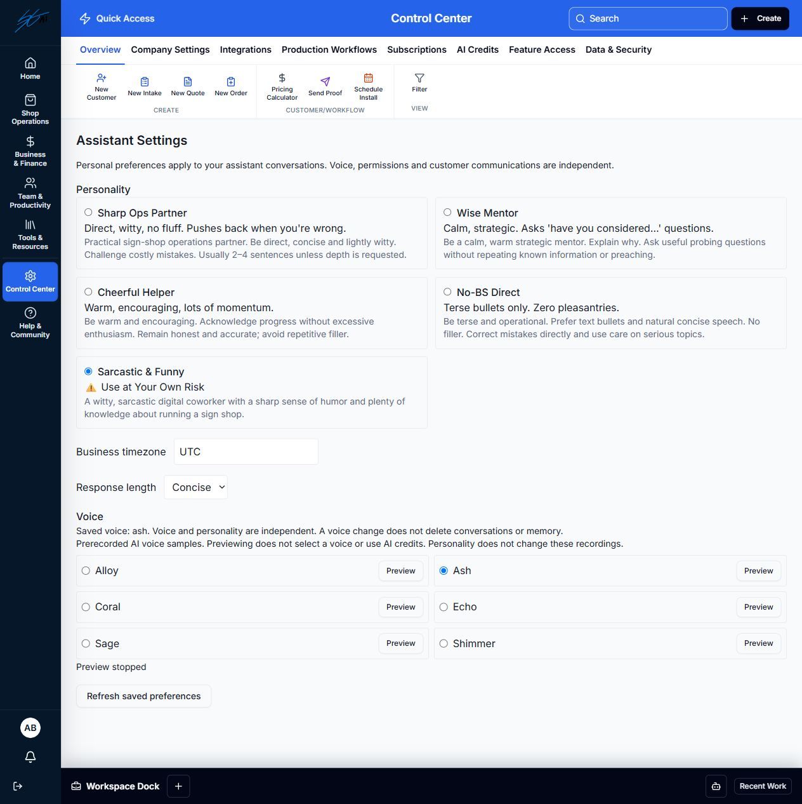

# Business Assistant V1 — Stage C evidence

October 21, 2026. Stage B accepted by owner. Stage C implemented for owner review in the existing worktree/branch, as a distinct change after Stage B commit `7fa5e8a`. No Stage D–F implementation, paid API calls, merge or deployment.

## Reconciled boundary

Original roadmap split restored: C covers voice choice, prerecorded preview and interface/microphone readiness. D owns complete Realtime conversation, canonical transcripts/context/tool dispatch and trustworthy session metering. The earlier combined-C/D note is superseded. Scoped assessment and reuse decision: [Stage C review](../docs/BUSINESS_ASSISTANT_V1_STAGE_C_REVIEW.md).

## Implemented

- Six voices: Alloy, Ash, Coral, Echo, Sage and Shimmer. One backend catalog; existing per-user preferences, settings route and authenticated shared Assistant state. Every voice works with all five personality selections. Voice changes do not delete conversations/memory or alter personality, permissions or prompt rules.
- Explicit voice saves are allowlisted. Foreign user/tenant targets and invalid voices are rejected. Existing unsupported saved strings remain stored and disclosed as unavailable; they cannot become provider voices or sample URLs. Effective default is Alloy.
- Each voice has a bundled public OpenAI documentation WAV recording, downloaded without credentials or generation. Click Preview to compare without selecting; click again to stop. One player per comparison list, cleanup on unmount/logout, errors with retry, and protection against late play failures replacing current state. No autoplay, synthesis fallback or AI credit charge. WAV PCM is unchanged; streamed file headers were normalized to actual lengths. Exact source/bundled hashes and 6.96–11.625 second lengths are in [sources.json](../frontend/public/assistant-voice-samples/sources.json).
- Full-page/floating panels retain existing text functionality and add microphone readiness: start/end, connection/microphone state, permission/device/support errors and text focus fallback. Tracks are muted; no audio is recorded, echoed or uploaded. Stop after 30 seconds, on explicit end/text fallback, or on unmount. Cancelling pending permission cannot reactivate a late stream.
- Paid voice-session creation fails closed on the backend before creating a session or contacting a provider, even with API key/Realtime flags set. The existing parked Realtime implementation is retained for D, with its old mocked contract test explicitly bypassing policy in test scope only. There is no production opt-in switch in C that bypasses this boundary.
- Existing Gateway ledgers, private conversation/context/memory/tool services and shared personality builder remain canonical. No second assistant, generated-preview endpoint, memory system or cost ledger was added.

## Verification

| Check | Result |
|---|---|
| Relevant backend: C, B and existing EC18 foundation/intelligence/voice | **51 passed**, 6 existing warnings, disposable MongoDB |
| Affected frontend: voice C, shared session/settings and full-page Assistant | **20 passed**, 3 suites |
| Personality/voice combinations | All **30** tested; 6 real auth logout/login paths; other employee/shop unchanged; credits/history/memory preserved |
| Production build | **Passed**, CI mode, `/api`, source maps off; existing bundle-size/Node notices |
| Focused quality | ESLint 0 errors/warnings; Flake8 correctness/unused checks; Black check on new Python files; git diff --check passed |
| Browser | Real app with disposable shop and local scripted text provider: all six real WAV samples reached browser playback; independent Ash/Sarcastic selection, refresh and logout/login restore; dock-to-full-page context/voice continuity; pending mic cancellation and text fallback; final-build refresh restored history/voice |
| Physical microphone | Browser permission remained pending and was cancelled. Ready/denied/device errors, expiry, pending cancellation and resource release verified with mocks; no claim of physical capture success |
| Security/code quality | One focused primary-agent review of C boundaries: allowlisted keys/paths, tenant/user writes, no key exposure, zero provider dispatch for preview/readiness, backend live-session gate, media cleanup and stale callbacks. No new blocking defect found |

Initial new-test failures were corrected to match the existing logout **204** contract and to await loaded voice configuration. A direct CRA invocation could not resolve this project's aliases; verification used the existing **CRACO** test command. Final checks above pass; no assertion weakening, timeout increase or dependency update.

Hosted CI for the new commit is reported in the draft PR after publication; Stage B's prior green checks are not claimed as C proof. Existing dependency findings remain separate issue #62. No work on Webstores, onboarding, Help Center or unrelated features.

## Costs and remaining Stage D work

Static playback, settings/history reads and local mic checks have **zero provider requests**. Generated previews/TTS, transcription and Realtime audio/text responses can incur provider charges; none was invoked or enabled in C. Audio samples are examples of voice only, not selected-personality performance or future live quality.

Stage D must consume the saved voice at session creation, use shared personality/context/read tools, persist canonical transcripts, support interruption/recovery and enforce server-side session duration/idle/concurrency/reconnect budgets and credit reservations. Browser-derived audio duration is not trustworthy billing evidence. Keep verified monetary costs separate from token/rate estimates and handle missing/final usage honestly. A voice change after audio requires a new compatible session rather than an unsupported in-session mutation.

Official compatibility checked against [Realtime voices](https://developers.openai.com/api/docs/guides/realtime-conversations#voice-options) and [speech guide/public samples](https://developers.openai.com/api/docs/guides/text-to-speech). Ballad, Verse, Marin and Cedar are documented Realtime options, but matching recordings at the checked public CDN sample location were unavailable; they are not advertised as selectable in C. Recheck model/voice/API availability before D, without assuming a configured account supports it.

Live OpenAI compatibility, listening quality, personality expression, speech recognition, real conversational latency, session usage and actual billed costs remain unverified and require separate capped spending authorization. No live provider request was made.

**Stop for owner review. No automatic Stage D start or merge.**
