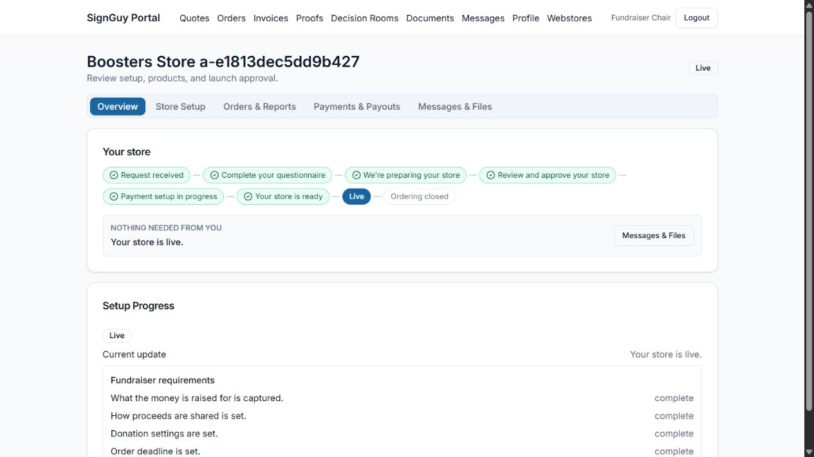
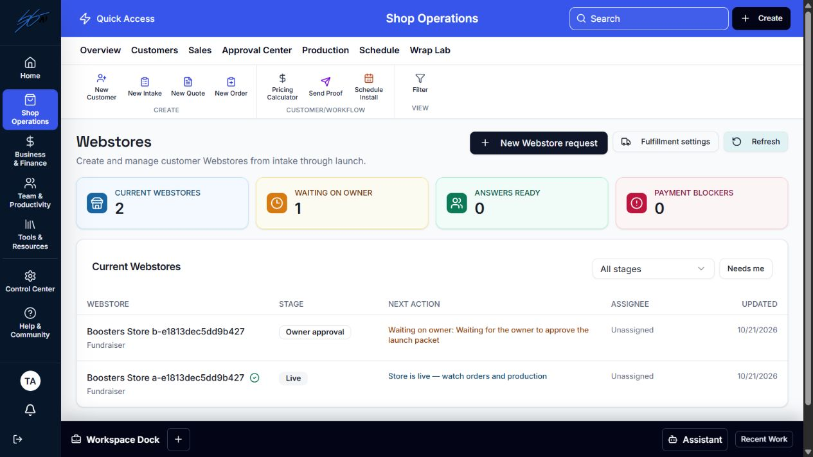
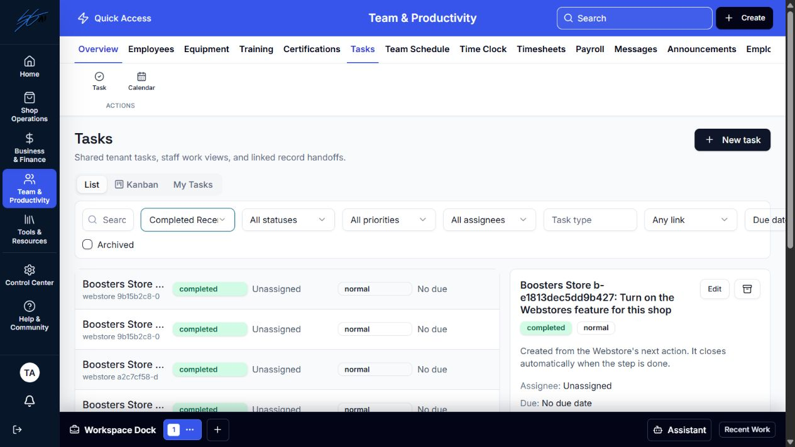

# Webstores Phase 3 stabilization

## Phase Review and Code Quality Assessment — before implementation

Owner's October 21 stabilization request authorizes this bounded implementation and one unmerged PR after this brief review. Baseline: merged PR #59, main `7973c8b`. The local owner checklist and acceptance review are preserved and excluded from Git.

| Subsystem / source | Assessment | Decision and smallest correction |
|---|---|---|
| `webstore_stage.py`, existing route synchronization dependencies | Clean: canonical stage/status writer and post-change hooks already exist | Keep lifecycle, routes and event history; do not create another status calculation |
| `webstore_next_action.py` | Needs cleanup: live monitoring produces a task; snapshot is written before task work succeeds; failed/expired leases have no reconciliation entry point; completed rows are reopened | Extend existing sync/lease/retry path; distinguish informational actions; record success only after task work; preserve completed rows when a condition recurs |
| `commercial_entitlements.py`, `webstore_payment_boundary.py` | Needs cleanup: external gate writes do not notify Webstore synchronization | Call tenant-scoped reconciliation after projection/provider updates; keep billing/payment rules unchanged |
| Existing shared `task_service.py` | Clean: idempotent creation, tenant links, audited transitions, assignment history | Reuse unchanged; no duplicate task store, scheduler or notification system |
| Owner progress/welcome and staff list | Needs cleanup: progress contains staff-only placeholder rows, welcome is unconditional, Refresh only reads | Derive owner guidance from canonical journey/next action; expose authorized recovery through existing staff Refresh and initial list load; keep GET reads free of sync writes |

**Scope:** one focused correction across these dependencies. No pricing, P1, donor edits, message email, cosmetic employee/status formatting or duplicate-button cleanup. Complexity is moderate because retries/concurrency and completed history must agree. The risk is stale external gate state or lease takeover producing wrong/duplicate tasks; verify those boundaries directly rather than repeat the general acceptance investigation.

**Workflow:** normal changes update the existing next-action projection/tasks; commercial/provider gate changes reconcile that tenant. Opening/refreshing the staff list recovers old failures and interrupted updates through an explicit POST, then reloads current data. Owner steps generate no staff task; live monitoring remains an informational status. Owners see stage-appropriate progress and questionnaire guidance from that same action producer. Buyers/prices/checkout are unchanged.

**Acceptance:** entitlement changes, owner turns/approvals and lifecycle transitions agree across list/detail/tasks/portal; transient/permanent failure and expired-lease recovery are idempotent; completed task history remains intact; other tenants cannot be read or synchronized. Focused backend/frontend regressions plus representative isolated staff and owner browser screens, then one normal CI cycle. Owner approval required before merge.

## Implementation and verification

Implemented in the focused stabilization candidate; merge and deployment remain unauthorized.

- Kept the canonical stage/action producer, task service, route hooks and activity history. Added tenant-scoped reconciliation after entitlement/provider writes and through the manage-protected staff POST used on list entry and Refresh. GET readers do not synchronize tasks.
- Informational live monitoring and owner turns have no generated staff task. Obsolete active tasks close through the existing audited task service. A recurring action creates a new occurrence instead of reopening a completed row or erasing its completion history.
- Success snapshots publish after task work succeeds. Retries, failure markers, expired-lease recovery and lease-owner fencing use the existing lock collection. Active leases report pending; the UI exposes failure/pending state with a Refresh retry.
- Staff list freshness includes snapshot version and source update time. Staff detail and owner progress use canonical stage/action labels; welcome/questionnaire prompts appear only when the canonical owner action requires them.
- Provider-boundary regression testing exposed two direct persistence defects: overlapping `$set`/`$setOnInsert` fields caused a MongoDB path conflict, and `or` retained prior true/nonempty gate values when the provider explicitly supplied false/empty. Corrected those persistence operations without changing provider activation, fee or pricing rules.

### Focused verification

- Backend: 43 tests across Phase 3 action/stage, the nine stabilization regressions, existing Phase 1 payment safety and entitlement tests. The combined run initially exposed one new fixture missing an entitlement ID; replaced that insert with the canonical test entitlement helper and reran the affected set.
- Frontend: 33 passing focused tests across `WebstoresStage1`, `WebstoresStage3Branding` and `WebstoreOwnerProductApproval`. Coverage includes the recovery warning/retry, informational actions excluded from Needs me, initial/returned questionnaires, terms turns and live owner guidance. An initial test-only expectation for an unrendered template name was corrected to check the actual questionnaire submit control.
- Read-only review of synchronization/recovery boundaries: PASS, no confirmed blocker in tenant scoping, recurrence/history, active/expired leases or failure/retry behavior. This is agent review, not owner approval.
- Isolated browser smoke, October 21: normal owner password login; live Overview says “Your store is live” without the introductory questionnaire prompt or staff placeholder progress; Store Setup opens with branding and no repeated questionnaire. Normal staff login; recovered list and detail agree on owner approval; Refresh completes without warning; Needs me excludes the owner turn and informational live store; All Active tasks is empty and Completed Recently retains the four superseded tasks.
- Browser target: run-owned private MongoDB and temporary file storage, fresh isolated tenants and credentials, dev auth bypass off and provider keys absent. Corrected a local ignored harness helper to discard an interrupted run's stale fixture file before reseeding. The test-only entitlement was applied only to the proved private server/current fixture. Owned servers/private MongoDB were disposed; normal development data and prior acceptance screenshots were preserved.
- `git diff --check`: clean. Required GitHub CI is the normal push + PR cycle; its exact-head result is recorded in the PR and local checklist after completion.

Representative browser evidence:

### Remaining boundary

Recovery is event-driven and also available on authorized staff list entry/Refresh. There is no unattended scheduler in MVP; the deployment-stage scheduler remains deferred. A still-running lease can legitimately remain pending until it releases/expires and recovery runs again. Cosmetic employee/status labels, duplicate actions and pure wording polish remain deferred; configurable message email remains a separate enhancement. No Phase 4, P1, pricing logic, Price Lab/Engine, live provider activation or production deployment changes are included. Owner review and explicit approval are required before merge.

## Connectivity recovery and late PR findings — October 21

The owner requested recovery of the existing work after connectivity loss. The worktree was clean at `73b985b`, matching PR #60; all six checks on that head were successful. Main still contained merged Phase 3a/b/c and PR #59. No implementation, browser evidence, commit or push was lost. However, GitHub's automatic review posted three P2 findings at 20:22 UTC, just after the prior closeout. These were legitimate unfinished Phase 3 corrections, addressed in the same branch/PR:

1. **Long-running lease:** lock-owner fencing originally protected release/failure markers only. Synchronization now renews the existing lease during slow I/O and checks/renews ownership before mutations. Losing ownership cancels outstanding synchronization and prohibits stale retries. Regressions exercise a task operation lasting more than twice its lease and a replacement owner finishing while the old operation is blocked.
2. **Task metadata drift:** recovery originally checked count/key/archive state only and could miss a manually edited title, assignee, type or source. It now uses the same canonical metadata as the writer, validates the active assignee, and locates generated rows by their tenant-scoped immutable key even when their source/type was edited. Repairs reuse the same task ID and audited task services; obsolete generated rows still complete normally.
3. **Billing callback latency:** the gate-change hook originally awaited an unbounded tenant scan. It now excludes lifecycle states whose action cannot change with external gates, limits callback work to 25 prelaunch stores and a one-second budget, and cancels incomplete work safely. Staff entry/Refresh retains the full tenant-scoped recovery path for overflow, old live/archived task cleanup or timeout. No scheduler, queue or detached background worker was added.

**Validation after these changes:** 14 stabilization tests passed, plus 34 existing stage/action, entitlement and payment-safety tests (48 total). Frontend code and owner/staff screens are unchanged; the 33 focused frontend tests and isolated browser evidence above are retained rather than repeated. Whitespace check is clean. Required CI must validate the changed head; current result and head are recorded in PR #60 and the local checklist. No extra review campaign or manual CI reruns are requested.

**Roadmap recovery:** the next Webstores phase remains Phase 4 (catalog/configuration and pricing/fulfilment foundation), with implementation authorization and shared-pricing dependencies still held. The corrected ownership/dependency discussion already exists in local doc 11; older references to building a new `pricing_engine.webstore` module are not new authorization. No Phase 4/P1, onboarding, Help Center, Business Assistant, paid-provider evaluation or deployment work was started.
